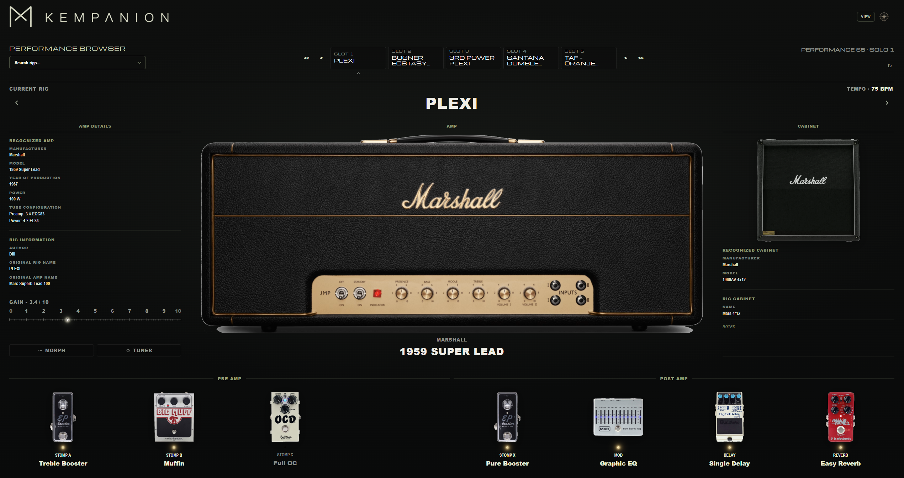
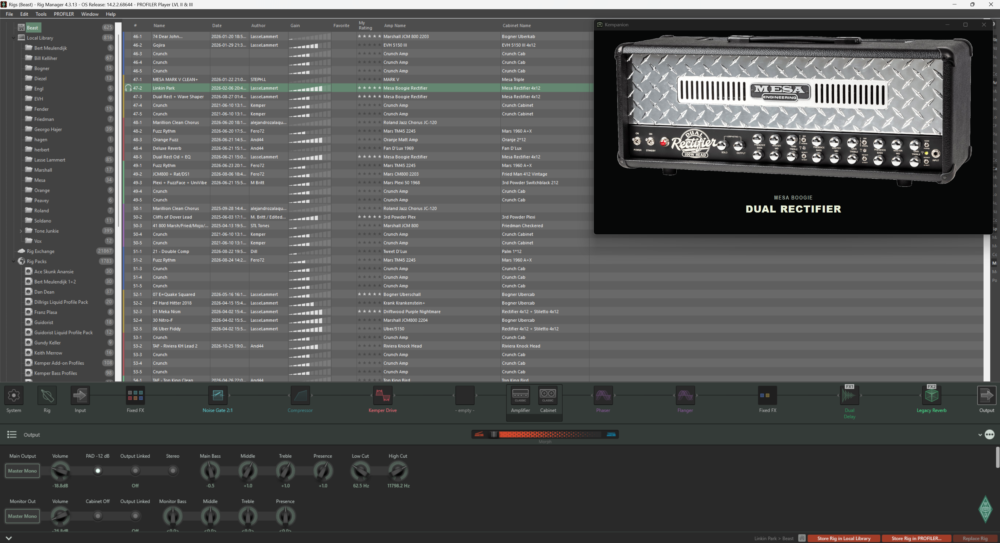
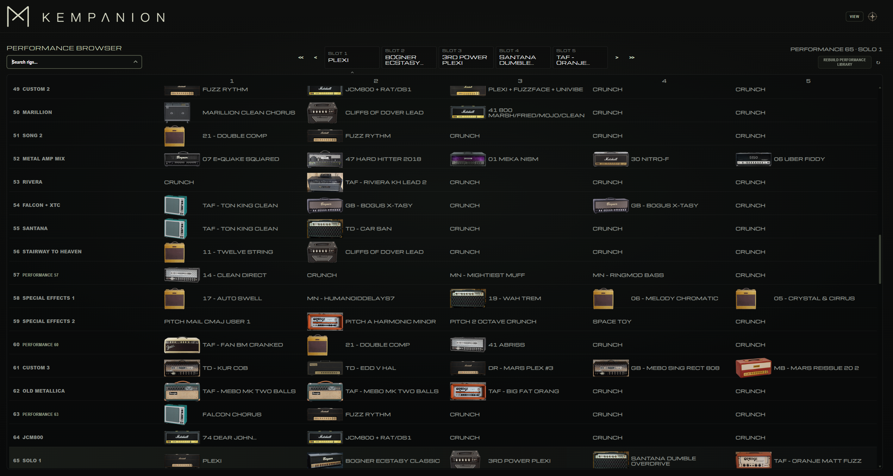

# Kempanion

Kempanion is a Windows desktop companion for the Kemper Profiler. It connects **Live View** (MIDI-driven rig control and overview) with **Gear Atlas** (a searchable visual amp library) in one application.

The product idea is simple: what runs on the Profiler should be easy to recognize—not only as text, but as the amplifier behind the rig, with a path to deeper model information when a match exists in the database.



---

## Live View

Live View uses the **Web MIDI API** (with **SysEx** enabled) to talk to the Kemper. You choose the MIDI **input and output** ports in Kempanion and connect when the Profiler is reachable on those ports. When connected, Live View reads the **current rig directly from the Profiler**—active rig, amp and cabinet labels, effect slots, gain, tempo, and related controls (including tuner and morph where supported). This live data does not depend on the Performance Browser’s cached library.

The **Gear Atlas** is Kempanion’s visual amp catalog—the same record set powers Live View matching. When matching succeeds, Kempanion shows the corresponding **amp image** and library-backed details. **Cabinet** display combines library resolution with a dedicated image map for common configurations. Clicking the amp image opens the shared **amp detail overlay** without leaving Live View.

### Configurable layout

The **View** menu toggles which blocks are visible (settings persist locally):

| Toggle | Section |
|--------|---------|
| Performance Browser | Performances, slots, and library tools |
| Effects | Stomp and post-amp effect overview |
| Amp Details | Technical amp readout alongside the image |
| Cabinet | Cabinet image and labels |

**Amp Only** hides everything except the amp image and caption, resizes the window to a compact footprint on desktop, and can keep the window above others while that mode is active.

Switch to Gear Atlas with the **compass** control; return to Live View with the **Kempanion signet**.



---

## Performance Browser

Each Kemper performance holds **five rig slots**. The Performance Browser is built on a **local library** Kempanion stores on your PC (performance/slot rig names and amp tags read from the Kemper). It is separate from Live View’s real-time rig readout: browsing and search use this cache, so after you change performances or rigs **on the Kemper**, you may need to **refresh** that data (see below).

### Building and refreshing the library

- **Rebuild Performance Library** (full scan) — Reads slot data from the Kemper over MIDI and builds or replaces Kempanion’s local library. The Profiler **steps through its performances** during the scan; Kempanion warns that the current performance/slot on the device will change and that the scan can take several minutes. Run an initial scan to populate the browser; run it again when Kemper-side setups have changed enough that the cached overview is out of date.
- **Reload** (↻ on the current performance) — Re-reads **only the selected performance’s five slots** from the Kemper and updates that slice of the local library. Use this when you edited rigs in one performance and do not want a full rescan.

Slot entries get **gear-library amp IDs** via the same text matching as Live View. When the Profiler’s current rig name matches **exactly one** library slot, the browser can highlight that performance and slot.

### Custom performance names and rig notes (local only)

Kempanion adds organization the Kemper does not provide as the same editable metadata in this app:

- **Performance names** — Assign your own label to each performance index (e.g. “Studio set”, “Solo night”) so the Performance Browser and Explorer show *what that bank is for*, not only “Performance 42”. Click the performance title in the browser or edit names in the Performance Explorer.
- **Rig notes** — Add free-text notes for the **selected performance slot** (e.g. Performance 12, Slot 4). Each slot has its own note, even when two slots use the same rig name; renaming a rig on the Kemper does not move a note to another slot.

Names and notes are saved **only in Kempanion’s local performance library file** on this computer (with a browser storage fallback if the desktop save path is unavailable). They are **not** written back to the Kemper and are **not** synced to other machines. Custom performance names and slot notes are **kept across a full library rescan** and when you **Reload** a single performance; scanned slot/rig text always comes fresh from the Profiler. Older libraries that stored notes by rig name are migrated when possible; ambiguous legacy notes remain under `rigNotesLegacy` until you reassign them.

Together, custom names, notes, and the Explorer search help you keep an overview of what each performance and rig is intended for without relying on Kemper rig names alone.



---

## How rig and amp matching works

Live View does **not** use AI or fuzzy “semantic” guessing. It compares Kemper text (rig name, amp name, manufacturer, and model) to the **Gear Atlas amp catalog** using fixed rules: known **aliases** and model strings, longest matching substring wins.

**Why matching is hard:** Rig names on the Kemper are **your** labels. They often omit official manufacturer and model wording—for example shortened names like `Mars` instead of `Marshall`, descriptive titles like `Fender Fan`, or typos such as `Duel Rectifier` instead of `Dual Rectifier` (illustrative examples only). Kempanion looks for catalog **aliases and text**, not what you “meant”, so a valid amp in the Gear Atlas may still fail to match automatically.

**Catalog vs automatic match:** Any amp in the Gear Atlas can be opened manually, but Live View shows an image only when the matcher picks an entry. **No amp image does not always mean the model is missing from the catalog**—search the Gear Atlas by the real manufacturer and model. If the model is **not** in the catalog, it is not available in Kempanion’s amp library yet.

There is **no confidence score** and **no disambiguation UI**—one winner or no image.

Technical detail: [Gear Library architecture](docs/GEAR_LIBRARY.md) (data model, aliases, API) · [System architecture](docs/ARCHITECTURE.md) (Live View pipeline, performance library).

---

## Gear Atlas

Gear Atlas is Kempanion’s **visual amp catalog**—search, manufacturer filtering, sorting, and chapter-style navigation over the same amp records Live View uses. **Manufacturers** and **Amps** are the active categories in the app today; additional gear categories exist in the data model but are not yet exposed in the Atlas UI.


**Standard browse and Collections** — card grids and themed collection layouts for exploration.

**Museum Mode** — one amp at a time, exhibition-style presentation within the Atlas.

**Timeline** — amps arranged by production era and year where that metadata exists.

**Presentation Mode** — reduced chrome and a presentation-oriented full-screen frame (independent of Museum layout).

Amp detail views show images and metadata fields when present in the database (descriptions, history, specs, and similar).

---

## Technology

| Layer | Role |
|-------|------|
| **Tauri 2** | Desktop shell, window behavior, bundled amp image resources |
| **Vite** | Frontend build and dev server |
| **Vanilla JavaScript (ES modules)** | UI, MIDI, Gear Atlas, Live View logic |
| **Rust** | Persisting the performance library JSON under the user data directory |
| **Web MIDI + SysEx** | Kemper communication from the embedded webview |

---

## Requirements, installation, and build

### Requirements

- **Windows** (installer target is NSIS)
- **Kemper Profiler** and a **MIDI connection** to the PC for Live View and performance library scanning
- Gear Atlas can be browsed without a connected Kemper; Live View and library scan/reload require MIDI

### Install

1. Download the installer from this repository’s **GitHub Releases** (when published).
2. Install and launch Kempanion from the Start menu.
3. Connect the Kemper via MIDI, then select the matching **MIDI input and output** ports in Kempanion and connect.

Populate the Performance Browser by running a **performance library scan** when prompted or from the performance section (this drives the Profiler through performances over MIDI).

### Build from source

```bash
git clone https://github.com/edmei014/Kompanion.git
cd Kompanion
npm install
npm run tauri:build
```

The NSIS installer is produced under `src-tauri/target/release/bundle/nsis/`.

---

## Project status

Kempanion is under active development (see `package.json` / Tauri app version). Live View, Gear Atlas, and the shared amp library are wired together; the amp catalog and UI continue to evolve.

---

## Author

**edmei014** — [github.com/edmei014](https://github.com/edmei014)

---

## Disclaimer

Kempanion is an independent third-party project. It is not officially affiliated with Kemper GmbH and is neither supported nor endorsed by Kemper.

“Kemper” and “Kemper Profiler” are trademarks of their respective owners and are used here solely to describe compatibility.
