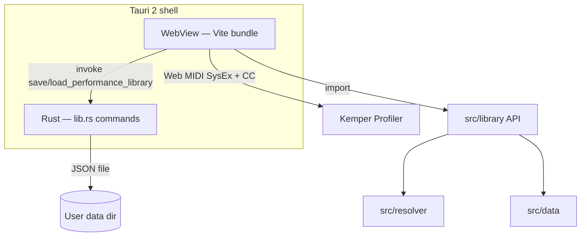
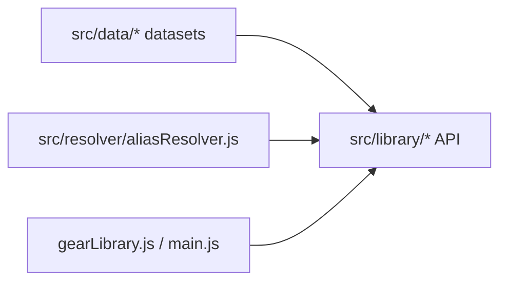

# Kempanion — System Architecture

This document describes how Kempanion is structured and how major subsystems behave, based on the current repository. For gear data conventions and contributor rules, see [Gear Library architecture](GEAR_LIBRARY.md).

---

## High-level overview

Kempanion is a **Tauri 2** desktop app whose UI is a **Vite-built** single-page application written in **vanilla JavaScript (ES modules)**. Almost all product logic runs in the frontend. **Rust** exposes a small set of Tauri commands for filesystem persistence of the performance library.

The entry point is `index.html`, which loads `/src/main.js`. That module wires Live View (MIDI), Gear Atlas (`gearLibrary.js`), bidirectional Kemper observation, and Live View layout (`liveViewMode.js`).



| Layer | Location | Responsibility |
|-------|----------|----------------|
| Shell | `src-tauri/` | Window, bundled resources, performance library I/O |
| Live + MIDI | `src/main.js` | Connection, rig refresh, performance browser, cabinet merge |
| Gear Atlas UI | `src/gearLibrary.js` + view modules | Browse, museum, timeline, presentation |
| Gear data API | `src/library/` | Normalized records, search, view models, text→record |
| Resolvers | `src/resolver/` | Amp alias index; amp image base URLs (Tauri vs dev) |
| Live layout | `src/liveViewMode.js` | Section visibility, Amp Only window sizing |
| Always-on-top | `src/ampOnlyAlwaysOnTop.js` | Tauri `setAlwaysOnTop` for Amp Only |
| Bidirectional MIDI | `src/modules/bidirectional/` | Beacon lease, SysEx decode, parameter writes |

**Implemented:** Windows NSIS bundle target (`src-tauri/tauri.conf.json`). Other platforms are not configured in this repo.

---

## Frontend ↔ Rust communication

The frontend uses `@tauri-apps/api/core` `invoke()` wrapped in `invokeTauri()` in `src/main.js`. If invoke fails (e.g. browser-only dev without Tauri), the wrapper logs a warning and returns `null`.

| Command | Rust (`src-tauri/src/lib.rs`) | Frontend use |
|---------|-------------------------------|--------------|
| `load_performance_library` | Reads JSON from disk; missing file → `"{}"` | Primary load path |
| `save_performance_library` | Writes JSON atomically via `fs::write` | Primary save path |
| `get_performance_library_path` | Returns absolute path string | **Defined in Rust; not referenced from frontend JS in this repo** |

**Fallback persistence:** When `save_performance_library` invoke returns `null`, the same JSON is stored in `localStorage` under key `kemper-performance-library` (`readPerformanceLibraryDocument` / `savePerformanceLibraryDocument` in `src/main.js`).

**Path on disk:** Rust uses `dirs::data_dir()` + `com.codex.kemper-live-companion` + `performance-library.json`. Note: Tauri app `identifier` in `tauri.conf.json` is `com.codex.live-companion` — the data subdirectory name comes from the Rust constant, not the bundle identifier.

---

## Kemper MIDI: Control Change vs SysEx

All Kemper I/O goes through the **Web MIDI API** with **`sysex: true`** (`navigator.requestMIDIAccess({ sysex: true })` in `src/main.js`).

### Control Change (channel 1)

Used for **discrete performance navigation and simple actions** where the codebase sends MIDI CC bytes via `makeControlChange()` / `sendMidiSafe()`:

| Use | CC (examples) | Source |
|-----|---------------|--------|
| Performance select | 47 | `makePerformanceSelectCommand` |
| Next performance (library scan advance) | 48, value 0 | `makeRigNextCommand` |
| Rig slot select | 50–54 | `SLOT_SELECTORS` |
| Tap tempo | 30 | `CONTROL_CHANGES.tapTempo` |
| Tuner open/close | 31 | `CONTROL_CHANGES.tuner` |
| Morph press/release | 80 | `CONTROL_CHANGES.morph` |

Effect module definitions also list CC numbers per slot (`EFFECT_MODULES` in `src/main.js`); **live effect reads and toggles use SysEx parameters**, not those CC fields, in the current implementation.

### SysEx (Kemper manufacturer ID `00 20 33`)

Used for **reading and writing Profiler state**:

- **Read path:** `requestSysex()` sends a request buffer and parses the reply. Examples:
  - Current rig name — dedicated request (`requestCurrentRigName`)
  - String tags — rig/amp/cabinet labels (`STRING_TAGS`, `requestStringTag`)
  - Numeric parameters — gain, tempo BPM, effect on/off and type pages (`requestNumericParam`, `requestEffectModule`)
- **Write path:** `ParameterService` (`src/modules/bidirectional/ParameterService.js`) sends **SysEx Single Parameter Change (function 0x01)** via `buildSingleParameterChange`. Gain, tempo, and effect bypass toggles go through this layer (`control.writeScaled`, `toggleEffectModule` in `src/main.js`).
- **Bidirectional stream:** `BidirectionalDiscovery.js` maintains a **beacon lease** (SysEx communication frames with echo flag) so the Profiler pushes parameter updates. Incoming messages update `ParameterStateStore`; `handleBidirectionalLivePush` in `src/main.js` applies rig name, gain, tempo, and delay/reverb sync status to the Live UI when scans/slot loads are not in progress.

**Limitation:** MIDI behavior depends on correct ports, Kemper MIDI settings, and timing constants baked into `main.js` (e.g. `SLOT_SETTLE_MS`, `LIBRARY_SCAN_PERFORMANCE_COUNT`). There is no automated test harness in this repo that validates hardware timing.

---

## Performance library: scan, shape, and persistence

### Purpose

The Performance Browser uses a **local JSON document** mapping performance indices → slot records so the UI can browse and load rigs without re-querying the entire Profiler on every interaction.

### Scan algorithm (`scanPerformanceLibrary` in `src/main.js`)

1. Reset Profiler to performance 1 / slot 1 (`resetToFirstPerformance`).
2. Store starting rig name in document metadata.
3. For performance index `1 … LIBRARY_SCAN_PERFORMANCE_COUNT` (**125**, constant):
   - For each of **5 slots** (`SLOT_SELECTORS`):
     - Send slot select CC.
     - Wait `SLOT_SETTLE_MS`.
     - Read slot via `readPerformanceSlotLibraryEntry`: rig name (SysEx) + amp name/manufacturer/model tags (SysEx).
   - Save performance object under string key `"1"`, `"2"`, …
   - Update `_meta.completedPerformances`, `scanInProgress`.
   - If not last performance: send `makeRigNextCommand()` and wait `PERFORMANCE_ADVANCE_MS`.
4. Run `applyAmpMatchingToPerformanceLibrary(library)` (see matching section).
5. Set `_meta.scanComplete`, restore performance 1 / slot 1 in `finally`.

During scan, the Profiler **changes performance and slot** under remote control; the UI shows progress via `renderLibraryScanProgress` and warns the user in `index.html` that position will change and the scan may take several minutes.

### Reload (single performance)

`reloadCurrentPerformanceFromDevice()` (`src/main.js`) re-reads **only the currently selected performance index** via `readPerformanceSlotsForPerformanceFromDevice`, updates that key in `performanceLibraryDocument`, re-runs amp matching on those slots, saves the document, and restores the previously active slot. It does **not** rescan all 125 performances. Blocked while a full scan, slot load, or reload is already in progress.

### Kempanion-only metadata (local persistence)

Stored in the same JSON document as scanned slots (`savePerformanceLibraryDocument`):

| Key | Behavior |
|-----|----------|
| `performanceNames` | Map of performance index → custom label (`setPerformanceName`). Shown in browser/explorer; **preserved** when saving during/after rescan (`main.js` comment: names must survive rescan). |
| `slotNotes` | Map of **`performanceIndex:slotIndex`** (slots 1–5) → note text (`setSlotNote`). UI follows the current performance/slot context (`syncRigNotesInput`). Not written to Kemper. |
| `rigNotesLegacy` | Optional map of legacy **rig-name** notes that could not be migrated to a single slot (`hydrateSlotNotesFromDocument`). Preserved, not discarded. |
| `rigNotes` | **Legacy read-only** rig-name map; migrated on load to `slotNotes` when exactly one matching slot exists, otherwise moved to `rigNotesLegacy`. |

Persistence: primary path Tauri `save_performance_library` / `load_performance_library` (Rust: user data dir, `performance-library.json`); if invoke fails, the same JSON is written to `localStorage` key `kemper-performance-library`. No cross-device sync is implemented.

### Live View vs cached browser data

| Source | Used for |
|--------|----------|
| `requestLiveKemperData()` / `refreshLiveData()` | Live View UI — always queries the **connected** Kemper (SysEx/CC). |
| Performance library document | Performance Browser, Explorer, slot load navigation, rig-name highlight — **cached** until scan or reload updates it. |

Loading a browser slot sends MIDI to the Kemper and then refreshes Live View; until then, Live View reflects the Profiler state, not stale library text alone.

### Document shape

| Key | Meaning |
|-----|---------|
| `"_meta"` | `version`, timestamps, `originalRigNameAtStart`, `completedPerformances`, `scanInProgress`, `scanComplete` |
| `"performanceNames"` | Optional map of custom performance labels (preserved across rescans) |
| `"slotNotes"` | Optional per performance/slot notes (`"performanceIndex:slotIndex"`) |
| `"rigNotesLegacy"` | Legacy rig-name notes not migrated to a single slot |
| `"1"` … `"125"` | Objects keyed by slot `"1"`–`"5"` |

**Slot record (normalized):**

```text
{
  rigName, ampName, ampManufacturer, ampModel,
  ampId?   // added by matching pass; optional on legacy string-only slots
}
```

Legacy slots may be a **plain rig-name string**; `normalizePerformanceSlotRecord` upgrades them to the object shape with empty amp fields.

### Kemper sync in the browser

`resolveKemperRigSlotMatch()` compares the live rig name to every slot’s `rigName` in the library. It returns a `{ performanceIndex, slotIndex }` **only when exactly one** slot matches. Zero or multiple matches → no automatic selection (indicators only).

Rig prev/next navigation walks a flat sequence of all performance/slot pairs in the library (`buildRigNavigationSequence`), not Kemper hardware buttons alone.

---

## Amp matching and the Gear Atlas catalog

**Gear Atlas** is the user-facing catalog; **Gear Library** (`src/library/`, `src/data/amps/`) is the shared data and API. Live View and the performance library use the **same amp records** as the Atlas—there is no separate recognition list.

**Implemented behavior:** deterministic **substring alias matching** with **longest alias wins**. There is no fuzzy match, ML, confidence score, or user-facing ambiguity resolution. Full field list, alias index rules, and contributor guidance are in [GEAR_LIBRARY.md](GEAR_LIBRARY.md).

### Pipeline

1. **Data:** `src/data/amps/*` → `allAmpRecords` → normalized via `createAmpRecord()` (`manufacturerId`, `aliases`, optional `image`, `theme`, `isCombo`, …).
2. **Index:** `src/resolver/aliasResolver.js` — per amp: `aliases[]`, `model`, `"<manufacturer> <model>"`, and manufacturer `&` / `and` variants; sorted by alias length descending.
3. **Per-string score:** Trim + lowercase; `normalized.includes(alias)`; keep longest match (`entry.length > bestLength`).
4. **Multi-source:** `resolveAmpIdFromSources(...sources)` scores each source; **global longest** wins.
5. **Live:** `resolveLiveAmpRecord(rigName, ampName, ampManufacturer, ampModel)` in `src/main.js` calls `resolveAmpRecordFromTextSources(ampName, rigName, ampManufacturer, ampModel)` — Kemper SysEx string tags, **not** rig author.
6. **Display:** On success, `getAmpImage(ampId)` and `getAmpDetailView(ampId)`; if `ampImageSrc` is null, Live View leaves the amp image area empty (Kemper text labels remain).

**Gear Atlas browse** uses `searchAmps()` (substring over manufacturer, model, and aliases)—a **different** code path from Live matching, intended for manual lookup when automatic matching fails.

### Performance library enrichment

`enrichPerformanceSlotWithAmpMatch` sets `ampId` when resolution succeeds. Stored IDs are reused for thumbnails via `getAmpPerformanceThumbnail` in the browser UI.

### Known limitations (code-defined)

| Topic | Behavior |
|-------|----------|
| Catalog vs Live | An amp can be in the Atlas but not auto-match if Kemper strings lack a matching alias |
| Tie on equal alias length | Index sorted by length descending; `>` comparison means **first matching alias at that length** in index order wins |
| Short or generic aliases | Any substring match counts; no word-boundary rules |
| No match | No amp image in Live View; user can still search Gear Atlas by manufacturer/model |
| Missing catalog entry | No library image or detail until a record is added to `src/data/amps/` |
| User-defined rig names | Kemper rig names are free text; nicknames, typos, or abbreviations may not contain any catalog alias (see README examples) |
| Rig author | Not passed to the matcher (`main.js` comment) |
| UI feedback | No list of alternate candidates |

---

## Live cabinet matching (distinct from amps)

Live cabinet display merges **two mechanisms** in `requestLiveKemperData` / `buildRecognizedCabinetView` (`src/main.js`):

### 1. Gear Library cabinets (`src/library/cabinetLibrary.js`)

- Records from `src/data/cabinets/`.
- `resolveCabinetRecordFromTextSources` concatenates sources (name, manufacturer, model) into one lowercase haystack.
- Longest alias match among generated aliases; **aliases shorter than 3 characters are skipped**.
- Returns a cabinet record or `null` — comment: **never guesses**.

### 2. Legacy image map (`src/cabinetImageMap.js` via imports in `main.js`)

- `matchCabinetImageMapEntry(manufacturer, model, configuration)`:
  - Normalizes search text with `normalizeCabinetSearch` (lowercase + `CAB_BRAND_ALIASES` replacements).
  - Scores alias substring length; **+1000** when speaker configuration matches entry configuration.
  - Can supply image/manufacturer/model when library record is missing.

**Merge rule:** If library detail exists, prefer library fields; map can supply image fallback and extra “Configuration” row. If only map matches, UI uses map metadata and `/images/cabinets/...` paths.

**Difference from amps:** Cabinets use a **separate** resolver in `cabinetLibrary.js` (not `aliasResolver.js`), plus an additional static map layer. Gear Atlas UI category **Cabinets** is disabled in `gearLibraryCatalog.js` even though cabinet data and live matching exist.

---

## Gear Atlas and module boundaries

Gear Atlas UI lives primarily in `src/gearLibrary.js` (views, timeline, museum, collections, presentation). It **must** consume gear through `src/library/index.js`, not raw `src/data/` (enforced by project convention in `GEAR_LIBRARY.md`).



| Module | Role |
|--------|------|
| `src/data/` | Versioned records only (amps, cabinets, manufacturers, …) |
| `src/library/` | Normalization, search, `AmpBrowseEntry` / `AmpDetailView`, image URL helpers |
| `src/resolver/aliasResolver.js` | Amp ID from text; used by library, not imported by UI directly |
| `src/resolver/imageResolver.js` | Amp image base URLs via `initializeAmpImageResolver` / `resolveAmpImageSrc` (used by `ampLibrary.js`; Tauri resources in production, `/images/amps` in dev) |

**Enabled Atlas categories:** `manufacturers`, `amps` only (`gearLibraryCatalog.js`).

**Live ↔ Atlas:** `openAmpDetailsOverlay` (`src/modules/ampDetails/AmpDetailsOverlay.js`) binds to the Gear Library detail host so Live View can open the same amp card without navigation.

---

## Amp Only mode (window sizing and always-on-top)

Implemented in `src/liveViewMode.js` with Tauri window APIs; layout CSS is driven by `document.body.dataset.liveViewMode` (`amp-only` vs `sections`) and `live-view-section-hidden` on sections.

| Behavior | Detail |
|----------|--------|
| Visibility | Hides performance, effects, amp details, cabinet, and rig card; shows amp image + caption |
| Compact size | `LogicalSize(600, 500)` via `applyAmpOnlyCompactWindowSize` when Tauri runtime detected |
| Restore | Snapshot of maximized/fullscreen/outer size before compact; restored on exit |
| State | Persisted in `localStorage` key `kempanion.liveView.v2` with section toggles |
| Always-on-top | `syncAmpOnlyAlwaysOnTop(true/false)` from `src/ampOnlyAlwaysOnTop.js` — saves prior `isAlwaysOnTop`, sets true on enter, restores on exit; no-op outside Tauri |
| Image fit | `fitAmpOnlyImageLayout` scales amp image within window client area |

**Limitation:** In Vite-only browser dev (no `__TAURI_INTERNALS__`), compact resize and always-on-top are skipped; section hiding still applies.

---

## Amp images and bundled resources

Production bundles copy amp images into Tauri resources (`tauri.conf.json`: `resources/images/amps/`, `resources/images/amps-performance/`). Asset protocol scope allows `$RESOURCE/images/amps/**/*`.

`initializeAmpImageResolver()` runs at app startup before Gear Library init. Performance browser thumbnails use a separate `amps-performance` resource folder when available.

---

## Architectural limitations worth knowing

1. **Performance scan scope:** Fixed **125** performances × **5** slots; changing Kemper library size requires code changes.
2. **Scan side effects:** Profiler performance/slot changes during scan; user should expect audible/load changes.
3. **Matching:** Longest-substring alias only; ambiguous names resolve silently to one ID or none.
4. **Rig highlight sync:** Exact rig name equality; unique library-wide match required.
5. **Persistence IDs:** Rust data dir name (`com.codex.kemper-live-companion`) ≠ Tauri bundle identifier (`com.codex.live-companion`).
6. **Platform:** Bundle targets NSIS/Windows only in config; no macOS/Linux packaging in repo.
7. **Rust surface area:** No MIDI, matching, or gear logic in Rust — only performance library file I/O.
8. **Gear categories:** Several data categories exist under `src/data/` but Atlas UI enables amps/manufacturers only.
9. **Bidirectional MIDI:** Optional optimization path; Live refresh still uses explicit SysEx requests on rig changes; push handling is suppressed during library scan and slot load flags.

---

## Related documentation

- [GEAR_LIBRARY.md](GEAR_LIBRARY.md) — AmpRecord shape, alias matching, Gear Atlas vs Live lookup, images, adding amps
- [README.md](../README.md) — product-oriented overview and user-facing matching summary
