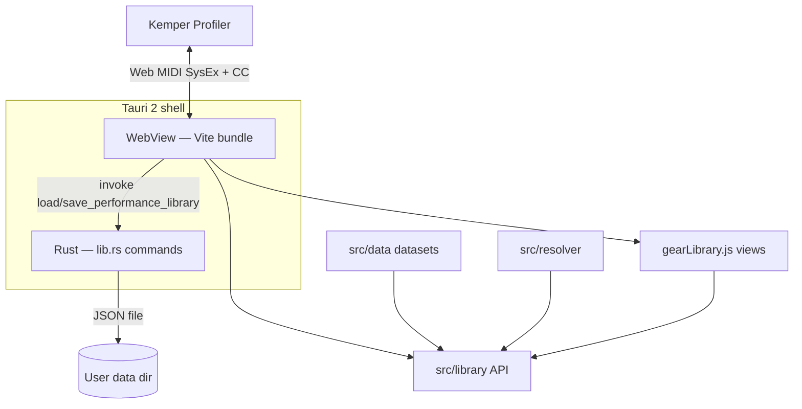
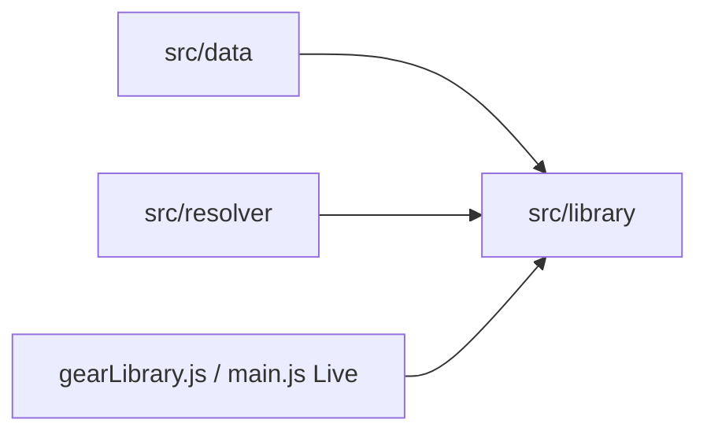

# Kempanion — System Architecture

This document describes how Kempanion is structured and how major subsystems behave, based on the current repository. For gear data conventions, alias rules, and contributor guidance, see [Gear Library architecture](GEAR_LIBRARY.md). For product-oriented overview, see [README.md](../README.md).

---

## 1. Overview and system architecture

Kempanion is a **Tauri 2** desktop app whose UI is a **Vite-built** single-page application written in **vanilla JavaScript (ES modules)**. Almost all product logic runs in the frontend. **Rust** exposes a small set of Tauri commands for filesystem persistence of the performance library only.

The entry point is `index.html`, which loads `/src/main.js`. That module wires Live View (MIDI), Gear Atlas (`gearLibrary.js`), bidirectional Kemper observation, and Live View layout (`liveViewMode.js`).



| Layer | Location | Responsibility |
|-------|----------|----------------|
| Shell | `src-tauri/` | Window, bundled resources, performance library I/O |
| Live + MIDI | `src/main.js` | Connection, rig refresh, performance browser, cabinet merge |
| Gear Atlas UI | `src/gearLibrary.js` + view modules | Browse and presentation modes (see README for product features) |
| Gear data API | `src/library/` | Normalized records, search, view models, text→record |
| Resolvers | `src/resolver/` | Amp alias index; amp image base URLs (Tauri vs dev) |
| Live layout | `src/liveViewMode.js` | Section visibility, Amp Only window sizing |
| Always-on-top | `src/ampOnlyAlwaysOnTop.js` | Tauri `setAlwaysOnTop` for Amp Only |
| Bidirectional MIDI | `src/modules/bidirectional/` | Beacon lease, SysEx decode, parameter writes |
| Slot notes helpers | `src/performanceLibrarySlotNotes.js` | Note key format, legacy migration |

**Implemented:** Windows NSIS bundle target (`src-tauri/tauri.conf.json`). Other platforms are not configured in this repo.

---

## 2. Runtime bootstrap

Startup is driven by `initializeApplication()` at the bottom of `src/main.js`:

1. `initializeAmpImageResolver()` — amp image base paths (Tauri resources vs dev).
2. `initializeGearLibrary()` — Gear Atlas data layer.
3. `initLiveViewMode(...)` — section toggles, Amp Only layout hooks.
4. `bootApplication()` — loads performance library from disk and MIDI ports in parallel.

`bootApplication()` calls `initializePerformanceLibrary()` (read JSON, hydrate slot notes) and `loadPorts()` (Web MIDI access, port list, auto-connect attempt). If MIDI is unavailable after boot, the app switches to Gear Atlas view (`setAppView("gear")`). Gear Atlas can be used without a connected Kemper; Live View and library scan/reload require MIDI.

Bidirectional discovery is created once (`initializeBidirectionalDiscovery()`), subscribed via `handleBidirectionalLivePush`, and started when MIDI ports open (`getMidiPorts()` → `bidirectionalDiscovery.start`).

**Port selection:** On each refresh, `preferProfilerPort()` selects input/output whose names contain `kemper` or `profiler`. A connection watcher retries `attemptConnection()` → `refreshLiveData()` every `RECONNECT_INTERVAL_MS` (2000) when ports exist but the app is not connected.

---

## 3. Persistence

### Frontend ↔ Rust

The frontend uses `@tauri-apps/api/core` `invoke()` wrapped in `invokeTauri()` in `src/main.js`. If invoke fails (e.g. browser-only dev without Tauri), the wrapper logs a warning and returns `null`.

| Command | Rust (`src-tauri/src/lib.rs`) | Frontend use |
|---------|-------------------------------|--------------|
| `load_performance_library` | Reads JSON from disk; missing file → `"{}"` | Primary load path |
| `save_performance_library` | Writes JSON with `fs::write` (direct overwrite, not atomic rename) | Primary save path |
| `get_performance_library_path` | Returns absolute path string | **Defined in Rust; not referenced from frontend JS in this repo** |

**Fallback:** When `save_performance_library` invoke returns `null`, the same JSON is stored in `localStorage` under key `kemper-performance-library` (`readPerformanceLibraryDocument` / `savePerformanceLibraryDocument`).

**Path on disk:** Rust uses `dirs::data_dir()` + `com.codex.kemper-live-companion` + `performance-library.json`. The Tauri app `identifier` in `tauri.conf.json` is `com.codex.live-companion` — the data subdirectory name comes from the Rust constant, not the bundle identifier.

### Document shape

| Key | Meaning |
|-----|---------|
| `"_meta"` | `version`, timestamps, `originalRigNameAtStart`, `completedPerformances`, `scanInProgress`, `scanComplete` |
| `"performanceNames"` | Optional map of custom performance labels (preserved across rescans) |
| `"slotNotes"` | Optional per performance/slot notes (`"performanceIndex:slotIndex"`) |
| `"rigNotesLegacy"` | Legacy rig-name notes not migrated to a single slot |
| `"1"` … `"125"` | Performance objects keyed by slot `"1"`–`"5"` |

**Slot record (normalized):**

```text
{
  rigName, ampName, ampManufacturer, ampModel,
  ampId?   // set after amp matching pass; optional on legacy string-only slots
}
```

Legacy slots may be a **plain rig-name string**; `normalizePerformanceSlotRecord` upgrades them to the object shape with empty amp fields.

### Kempanion-only metadata

Stored in the same JSON document as scanned slots (`savePerformanceLibraryDocument`):

| Key | Behavior |
|-----|----------|
| `performanceNames` | Map of performance index → custom label (`setPerformanceName`). **Preserved** on save during/after rescan. |
| `slotNotes` | Map **`performanceIndex:slotIndex`** → note text. Not written to Kemper. |
| `rigNotesLegacy` | Legacy **rig-name** notes that could not be migrated to a single slot (`hydrateSlotNotesFromDocument`). |
| `rigNotes` | **Legacy read-only**; migrated on load to `slotNotes` when exactly one matching slot exists, else `rigNotesLegacy`. |

No cross-device sync is implemented.

---

## 4. MIDI transport: CC and SysEx

All Kemper I/O goes through the **Web MIDI API** with **`sysex: true`** (`navigator.requestMIDIAccess({ sysex: true })` in `loadPorts` / `getMidiPorts`).

### Control Change (channel 1)

Discrete navigation and actions use `makeControlChange()` / `sendMidiSafe()` on **MIDI channel 1** (`MIDI_CHANNEL`, `STATUS_CONTROL_CHANGE`):

| Use | CC | Helper / constant |
|-----|-----|-------------------|
| Performance select (0-based index) | 47 | `makePerformanceSelectCommand` |
| Scan advance between performances | 48, value 0 | `makeRigNextCommand` (name in code only; Kemper-side label not defined in this repo) |
| Rig slot select | 50–54 | `SLOT_SELECTORS` |
| Tap tempo | 30 | `CONTROL_CHANGES.tapTempo` |
| Tuner open/close | 31 | `CONTROL_CHANGES.tuner` |
| Morph press/release | 80 | `CONTROL_CHANGES.morph` |

`EFFECT_MODULES` lists CC numbers per effect slot, but **live effect reads and toggles use SysEx parameters**, not those CC fields, in the current implementation.

**Performance navigation patterns:**

| Operation | Performance navigation | Slot navigation |
|-----------|------------------------|-----------------|
| **Full library scan** (`scanPerformanceLibrary`) | Start: `resetToFirstPerformance` (CC 47 → perf 1, then slot 1). Then **CC 48** after each performance’s five slots. **No CC 47** inside the scan loop for performances 2–125. | CC 50–54 per slot |
| **Reload** (`readPerformanceSlotsForPerformanceFromDevice`) | **CC 47** for target performance index | CC 50–54 per slot |
| **Browser slot load** (`loadBrowserPerformanceSlot`) | **CC 47** when Kemper is not already on that performance | CC 50–54 for target slot |

Performance browser **prev/next** buttons only change the selected performance in the UI (`selectPerformanceByOffset`); they do **not** send MIDI until the user loads a slot.

### SysEx (manufacturer ID `00 20 33`)

**Read path:** `requestSysex()` sends a request and parses the reply (default timeout **1200 ms**; current rig name **5000 ms**). On timeout, callers typically get `null`/empty and may log a warning.

Examples:

- Current rig name — `requestCurrentRigName` / `CURRENT_RIG_NAME_REQUEST`
- String tags — `STRING_TAGS`, `requestStringTag` (rig/amp/cabinet labels on **Live** reads)
- Numeric parameters — gain, tempo BPM, effect on/off and type pages (`requestNumericParam`, `requestEffectModule`)
- Rendered effect type names — `requestRenderedString`

**Write path:** `ParameterService` sends **SysEx Single Parameter Change (function 0x01)** via `buildSingleParameterChange`. Gain, tempo, and effect bypass toggles use this layer (`parameterService`, `control.writeScaled`, `toggleEffectModule` in `src/main.js`).

**Timing constants** (representative): `SLOT_SETTLE_MS` 500, `PERFORMANCE_ADVANCE_MS` 500, `PERFORMANCE_SELECT_SETTLE_MS` 700, `LIBRARY_SCAN_PERFORMANCE_COUNT` 125. There is no automated hardware test harness in this repo.

---

## 5. Bidirectional

`BidirectionalDiscovery.js` maintains a **beacon lease** (SysEx communication frames with echo flag, refreshed on `LEASE_REFRESH_MS` 500) so the Profiler can push parameter updates. Incoming frames update `ParameterStateStore`; subscribers receive decoded changes.

`handleBidirectionalLivePush` in `src/main.js` maps pushes to Live UI updates for:

- Rig name (debounced full `refreshLiveData` on change)
- Gain (unless local gain drag is active)
- Tempo BPM
- Effect on/off and type (with optional type-name enrichment)
- Delay/reverb sync status (write confirmation path)

**Push suppression:** Handlers return early when `performanceLibraryScanInProgress` or `isLoadingPerformanceSlot` is true. **`isReloadingCurrentPerformance` is not checked** in `handleBidirectionalLivePush` (reload still stops the rig monitor but push updates may still arrive).

### Hybrid Live path

When `canUseBidirectionalPushSync()` is true (bidirectional mode active and recent traffic within `PUSH_TRAFFIC_MAX_AGE_MS` 5000), the rig **monitor interval** skips steady-state polling of rig name and effects (`startRigMonitor`). Rig changes are driven by push + debounced `refreshLiveData` (`RIG_CHANGE_REFRESH_DEBOUNCE_MS` 180).

When push is not healthy, the monitor falls back to periodic SysEx polls (`requestCurrentRigName`, `requestEffectsData`, tempo refresh).

Explicit SysEx reads always run for **`refreshLiveData`**, **full scan**, **reload**, **slot load**, and **reconnect** regardless of push health.

---

## 6. Live View pipeline

Live View is **independent of the performance library document** for rig content:

- **`refreshLiveData()`** → **`requestLiveKemperData()`** reads the **currently active rig** from the connected Kemper via SysEx (and CC for actions such as tuner/morph).
- The performance library is **not** used to populate Live rig/amp/cab/effect data.
- A rig can appear in Live View even if its performance/slot was **never scanned**, as long as the Profiler provides the requested SysEx data.

After **`loadBrowserPerformanceSlot`**, the app sends CC to the Kemper, waits for rig name settlement, then calls **`refreshLiveData()`** so Live View matches the loaded slot.

### What Live reads (SysEx)

`requestLiveKemperData()` includes rig name, rig author, amp/cabinet string tags, speaker configuration, gain, tempo, and all configured effect modules. Cabinet display merges Gear Library resolution and `cabinetImageMap` (see §9).

### Amp match and display

`resolveLiveAmpRecord()` calls `resolveAmpRecordFromTextSources(ampName, rigName, ampManufacturer, ampModel)` — **rig author is not** an matching input.

When a match exists, Live View shows **manufacturer and model from the matched Gear Library `AmpRecord`**, not necessarily the raw Kemper strings (`liveData.manufacturer`, `liveData.ampModel` in `refreshLiveData`).

**Images:** If there is **no** amp match, `ampImageSrc` is omitted and the amp image area stays empty (text labels remain). If there **is** a match, `getAmpImage(ampId)` uses `resolveAmpImageSrc`, which returns a **placeholder** (e.g. `comingsoon.png`) when the record has no usable image file — so a matched amp can still show a placeholder, not an empty frame.

### Browser highlight (cache only)

`syncPerformanceBrowserWithKemperRigMatch()` (called from `refreshLiveData`) compares **live** `currentRigName` to cached slot `rigName` values. It selects a performance/slot in the UI **only when exactly one** library slot matches (`resolveKemperRigSlotMatch`). This does not change Kemper state.

Rig prev/next in the app walks `buildRigNavigationSequence()` (flat library order) and loads slots via `loadBrowserPerformanceSlot`.

### Live cabinet matching (amps separate)

In `requestLiveKemperData` / `buildRecognizedCabinetView`:

1. **Gear Library** — `resolveCabinetRecordFromTextSources` in `cabinetLibrary.js` (longest alias; aliases shorter than 3 characters skipped; returns `null` if no match).
2. **Static map** — `matchCabinetImageMapEntry` in `cabinetImageMap.js` for image/metadata fallback.

Library fields win when both apply. Gear Atlas UI category **Cabinets** is disabled in `gearLibraryCatalog.js` even though live matching uses cabinet data.

---

## 7. Performance library: scan, reload, and slot-load

### Purpose

The Performance Browser uses a **local JSON document** mapping performance indices → slot records so the UI can browse, search, and load rigs without re-querying the entire Profiler on every interaction.

### Full scan (`scanPerformanceLibrary`)

Triggered from `createPerformanceLibrary()` after user confirmation in **`#libraryConfirmDialog`** (`index.html`) — warns that Kemper position will change and the scan may take several minutes. There is **no mid-scan cancel** in the running scan UI (cancel applies to the confirmation dialog only).

Algorithm:

1. `resetToFirstPerformance` — CC 47 (performance 1) + CC 50 (slot 1), settles.
2. Store starting rig name in `_meta.originalRigNameAtStart`; save initial document.
3. For performance index `1 … 125`:
   - For each of **5 slots**: CC slot select → `SLOT_SETTLE_MS` → **`readPerformanceSlotLibraryEntry`** (SysEx only):
     - `rigName`
     - `ampName`, `ampManufacturer`, `ampModel`
     - **Not** read: rig author, cabinet tags, effects, or other Live-only fields.
   - Save performance under key `"1"`, `"2"`, …; update `_meta.completedPerformances`, `scanInProgress`.
   - If not last performance: **`makeRigNextCommand()`** (CC 48, value 0) → `PERFORMANCE_ADVANCE_MS`.
4. After all performances: **`applyAmpMatchingToPerformanceLibrary`** (adds `ampId` per slot). Intermediate saves during the loop **do not** include `ampId`.
5. Set `_meta.scanComplete`; **`finally`**: `resetToFirstPerformance` again.

During scan: `performanceLibraryScanInProgress` is true, **`stopRigMonitor()`** runs, bidirectional push handlers for Live are suppressed. Progress UI: `renderLibraryScanProgress`.

**Manual Kemper changes during scan:** The scan assumes sequential CC/SysEx control. There is **no code** that detects user-driven performance or slot changes on the hardware; such changes can **corrupt slot-to-data mapping**. Product docs warn users not to switch manually; that warning is architecturally justified but **not enforced in software**.

**Errors and partial state:** If the scan throws, `createPerformanceLibrary` catches, reloads whatever was saved, and shows an error. **`scanPerformanceLibrary`’s `finally`** still attempts Kemper reset to performance 1 / slot 1. A **partial** library (some performance keys filled, `scanComplete` false) can remain on disk.

### Reload (single performance)

`reloadCurrentPerformanceFromDevice()` uses **`readPerformanceSlotsForPerformanceFromDevice`** (**CC 47** + five slot CCs + SysEx reads), **`applyAmpMatchingToPerformanceSlots`** on that performance only, save, then **`loadBrowserPerformanceSlot`** to restore the previous slot. Blocked while scan, slot load, or another reload is active.

### Slot load from browser

`loadBrowserPerformanceSlot(performanceIndex, slotIndex)` sends **CC 47** (if needed) and slot CC, waits for rig name, **`refreshLiveData()`**. Sets `isLoadingPerformanceSlot` (suppresses push handling and browser kemper sync).

---

## 8. Matching hooks (Gear Library)

**Gear Atlas** is the user-facing catalog; **Gear Library** (`src/library/`, `src/data/amps/`) is the shared API. Live View and the performance library use the **same amp records** — no separate recognition list.

**Behavior:** deterministic **substring alias matching**, **longest alias wins**, no confidence score or disambiguation UI. Full rules, alias index construction, and contributor workflow: **[GEAR_LIBRARY.md](GEAR_LIBRARY.md)**.

| Hook | Function | Notes |
|------|----------|--------|
| Live amp resolve | `resolveLiveAmpRecord` → `resolveAmpRecordFromTextSources` | Sources: amp name, rig name, amp manufacturer, amp model |
| Library slot enrich | `enrichPerformanceSlotWithAmpMatch` | Same resolver; stores `ampId` on slots |
| Atlas browse search | `searchAmps` | Substring over manufacturer, model, aliases — **different** path from Live auto-match |
| Alias index | `src/resolver/aliasResolver.js` | Imported by `ampLibrary.js`, not by UI directly |

User-facing matching examples and “why no image” scenarios: **[README.md](../README.md)**.

---

## 9. Gear Atlas module boundaries

Gear Atlas UI lives in `src/gearLibrary.js` and related view modules. UI **must** consume gear through `src/library/index.js`, not raw `src/data/` (see **GEAR_LIBRARY.md**).



| Module | Role |
|--------|------|
| `src/data/` | Versioned records (amps, cabinets, manufacturers, …) |
| `src/library/` | Normalization, search, browse/detail view models, image URL helpers |
| `src/resolver/aliasResolver.js` | Amp ID from text (used by library) |
| `src/resolver/imageResolver.js` | `initializeAmpImageResolver`, `resolveAmpImageSrc`, performance thumbnails |

**Enabled Atlas categories:** `manufacturers`, `amps` only (`gearLibraryCatalog.js`).

**Live ↔ Atlas:** `openAmpDetailsOverlay` (`src/modules/ampDetails/AmpDetailsOverlay.js`) opens the same amp detail host from Live View without navigation.

Presentation modes (museum, timeline, collections, etc.) are product UI; see README, not duplicated here.

---

## 10. Desktop shell, Amp Only, and resources

### Tauri shell

Window defaults and NSIS bundling: `src-tauri/tauri.conf.json`. Rust does not implement MIDI, matching, or gear logic.

### Amp Only mode

Implemented in `src/liveViewMode.js` with Tauri window APIs when `__TAURI_INTERNALS__` is present:

| Behavior | Detail |
|----------|--------|
| Visibility | Hides performance, effects, amp details, cabinet, rig card; amp image + caption |
| Compact size | `LogicalSize(600, 500)` |
| Restore | Snapshot of maximized/fullscreen/outer size before compact |
| State | `localStorage` key `kempanion.liveView.v2` (section toggles + mode) |
| Always-on-top | `syncAmpOnlyAlwaysOnTop` from `src/ampOnlyAlwaysOnTop.js` |
| Image fit | `fitAmpOnlyImageLayout` |

In Vite-only browser dev, compact resize and always-on-top are skipped; section hiding still applies.

### Bundled amp images

Production copies amp images into Tauri resources (`resources/images/amps/`, `resources/images/amps-performance/`). `initializeAmpImageResolver()` runs at startup before Gear Library init. Asset protocol scope includes `$RESOURCE/images/amps/**/*` (`tauri.conf.json`). Performance browser thumbnails prefer the `amps-performance` resource folder when resolved.

Cabinet/effect images used by Live View are served from app static paths (e.g. `./images/cabinets/`, `./images/effects/`) as referenced in `main.js` — not the same Tauri resource bundle as full-size amp photos.

---

## 11. Known limitations

1. **Scan scope:** Fixed **125** performances × **5** slots; changing Kemper library size requires code changes.
2. **Scan navigation:** Full scan relies on **CC 48** after the initial reset; exact Kemper semantics of CC 48 are **not specified in this repository** (only `makeRigNextCommand` usage).
3. **Scan side effects:** Profiler performance/slot changes during scan; audible/load changes expected.
4. **No mid-scan cancel** and **no user-override detection** during scan (see §7).
5. **Partial library on failure** possible; Kemper reset attempted in `finally`.
6. **Matching:** Longest-substring alias only; ties and silent wrong-winner behavior — see GEAR_LIBRARY.md.
7. **Rig highlight:** Exact rig name equality; unique library-wide match required.
8. **Persistence:** Rust data dir name (`com.codex.kemper-live-companion`) ≠ Tauri bundle identifier (`com.codex.live-companion`).
9. **Platform:** NSIS/Windows only in config.
10. **Rust surface:** Performance library file I/O only.
11. **Gear categories:** Data exists for cabinets, effects, etc.; Atlas UI enables amps/manufacturers only.
12. **Bidirectional:** Push optimization when healthy; explicit SysEx still required for scan/reload/slot-load/reconnect. Push suppressed for scan and slot load, **not fully for reload**.
13. **SysEx timeouts:** Slow or missing Kemper replies yield empty/partial reads (scan slots may store empty strings).

### Open questions (not verified in repo)

- Whether CC 48 always advances exactly one performance bank on every Kemper configuration used with this app.
- Whether concurrent bidirectional traffic during scan can interfere with `requestSysex` request/response pairing (no isolation layer documented).

---

## Related documentation

- [GEAR_LIBRARY.md](GEAR_LIBRARY.md) — AmpRecord shape, alias matching, images, adding amps
- [README.md](../README.md) — product overview, setup, Performance Browser vs Live View
